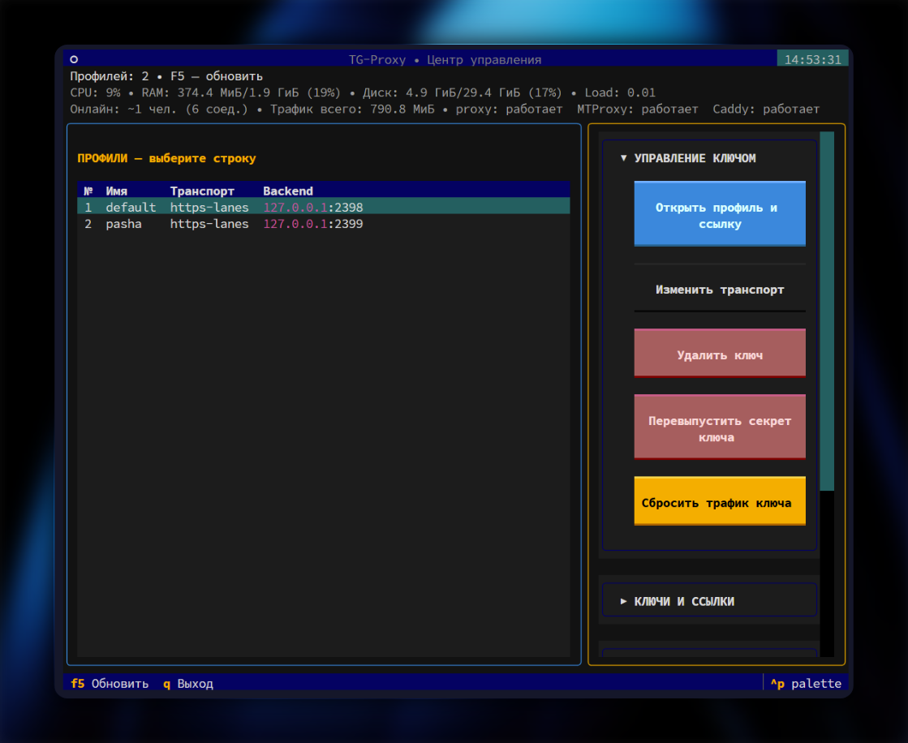
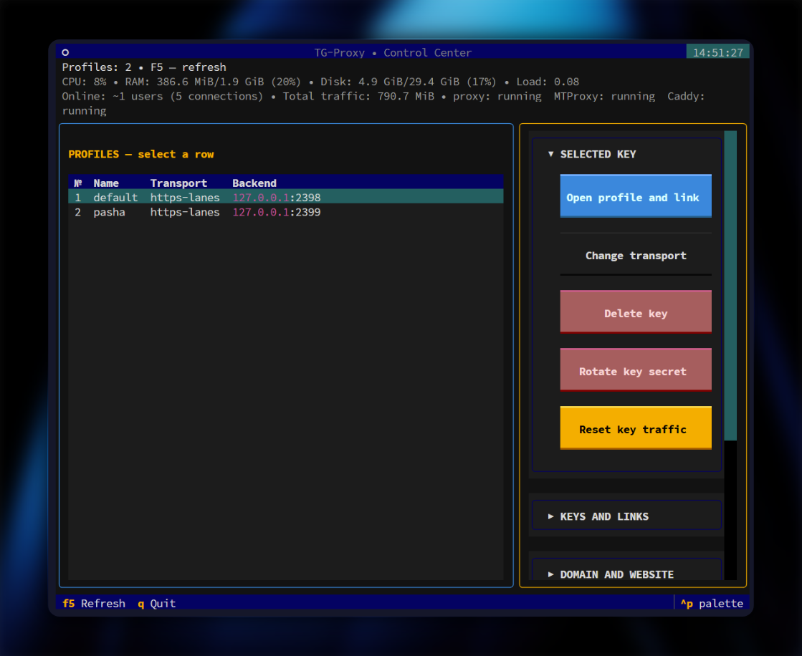

<div align="center">
  

  **Терминальная панель управления Telegram Web Proxy**<br>
  **A terminal control panel for Telegram Web Proxy**

  [](LICENSE)

  [Русский](#русский) · [English](#english)
</div>

## Русский

TG-Proxy устанавливает и помогает управлять [Telegram Web Proxy](https://github.com/telegramdesktop/tproxy-server), MTProxy и Caddy на сервере Linux. Панель работает в терминале по SSH, поддерживает русский и английский языки и позволяет выполнять основные действия в окнах интерфейса.

### Требования и установка

Нужен сервер Ubuntu 22.04+ или Debian 12+ (`x86_64`), доступ `root` или `sudo`, домен с A-записью на IP сервера и свободные порты 80 и 443.

```bash
sudo bash -c "$(curl -sSL https://raw.githubusercontent.com/IohnMorris/tproxy-server_CLI/main/install.sh)"
```

Мастер запросит язык, домен, email сертификата и транспорт. После установки запустите панель:

```bash
sudo proxy
```

В верхней части показана сводка, слева — профили, справа — действия. Раздел выбранного ключа открыт при запуске; остальные разделы можно раскрывать по мере необходимости. `F5` обновляет данные, `Q` закрывает панель. Доступна смена темы через командную палитру (`Ctrl+P`).

Копирование ссылки использует возможности SSH-терминала: поддержка буфера обмена зависит от клиента и его настроек. Если копирование недоступно, выделите ссылку мышью и скопируйте средствами терминала.



### Возможности

- Таблица профилей: выберите строку мышью или клавишей Enter, чтобы открыть карточку с ссылкой и статистикой. Ссылку можно скопировать через буфер обмена терминала.
- Создание и удаление ключей, смена транспорта для одного или всех ключей; поддерживаются `https`, `https-lanes`, `websocket`, `websocket-lanes`.
- Перевыпуск секрета, сброс трафика, смена пути и полная ротация с подтверждением.
- Смена домена с проверкой DNS и настройкой сертификата Caddy. Редактор HTML заглушки умеет очищать содержимое и сохранять новый сайт.
- Сводка CPU, RAM, диска, нагрузки, статуса служб, общего трафика и примерного онлайна. Число пользователей оценивается по TCP-соединениям; трафик показывается общим счётчиком, а не помесячно.
- Диагностика, снимок процессов, перезапуск служб, лимиты MTProxy и настройки маршрутизации.
- Проверка версии панели по тегам и коммита ядра при запуске; доступные обновления можно установить вместе. После успешного обновления интерфейс перезапускается.

### Транспорт

Транспорт определяет, как клиент обменивается данными с прокси. Режим можно выбрать при создании ключа или изменить позже для одного либо всех ключей; ссылка при этом сохраняется.

| Режим | Как работает | Когда попробовать |
| --- | --- | --- |
| `https` | Один POST и один long-poll для обмена данными. | Базовый вариант для совместимости. |
| `https-lanes` | Независимые POST и long-poll для отдельных потоков через HTTP/2. | Если нужна изоляция потоков или WebSocket недоступен. |
| `websocket` | Один общий WebSocket для потоков. | Если сеть поддерживает WebSocket и хочется использовать меньше соединений. |
| `websocket-lanes` | Отдельный WebSocket для каждого потока. | Для изоляции потоков, например чата и передачи медиа. |

Совместимость и скорость зависят от сети клиента: при проблемах попробуйте другой режим. При установке по умолчанию используется `https`.

### Лимиты и маршрутизация

Эти параметры доступны в разделе **«Сервис и обслуживание» → «Лимиты и маршруты»**.

- **Воркеры (Workers)** — число рабочих процессов MTProxy. Дополнительные процессы могут помочь при высокой нагрузке, но потребляют CPU и RAM. Для VPS с 1 vCPU начните с `1` и меняйте значение по результатам наблюдения за нагрузкой.
- **Максимум соединений (Max Connections)** — лимит, передаваемый MTProxy для каждого воркера. Увеличение лимита само по себе не ускоряет прокси: фактическая ёмкость зависит от CPU, памяти и сети. Начальное значение — `4096`.
- **Маршрутизация статики (Static Routing)** — режим обработки путей статического сайта: `exact` использует точное сопоставление, `legacy` сохраняет совместимость со старой логикой. Используйте `exact`, если обратная совместимость не требуется.

### Команды

```bash
sudo proxy                          # Открыть панель
sudo proxy users                    # Ключи, трафик и ссылки
sudo proxy add ivan websocket-lanes # Добавить ключ
sudo proxy mode ivan https-lanes    # Сменить транспорт ключа
sudo proxy mode all websocket      # Сменить транспорт всех ключей
sudo proxy del ivan                 # Удалить ключ
sudo proxy domain example.com      # Сменить домен
sudo proxy site                    # Редактор сайта в CLI
sudo proxy --rotate                # Ротация пути и всех секретов
sudo proxy --update                # Обновить ядро
sudo proxy --self-update           # Обновить панель из main
sudo proxy --self-update v1.0.0    # Установить панель из тега
sudo proxy --help                  # Справка
```

При интерактивном запуске выберите язык; для неинтерактивных команд можно указать `PROXY_LANG=ru` или `PROXY_LANG=en`. Сайт хранится в `/srv/tproxy-site/index.html`. После изменения HTML через панель службы перезапускаются. Смена секрета или пути делает соответствующие старые ссылки недействительными.

### Обновления

При запуске панель проверяет наличие обновлений и предлагает установить доступную версию. Обновление панели также можно запустить вручную командой `sudo proxy --self-update`.

## English

TG-Proxy installs and manages [Telegram Web Proxy](https://github.com/telegramdesktop/tproxy-server), MTProxy and Caddy on a Linux server. Its SSH-friendly terminal dashboard supports Russian and English.

### Requirements and installation

Use Ubuntu 22.04+ or Debian 12+ (`x86_64`), with `root` or `sudo`, a domain A record pointing at the server, and ports 80 and 443 available.

```bash
sudo bash -c "$(curl -sSL https://raw.githubusercontent.com/IohnMorris/tproxy-server_CLI/main/install.sh)"
sudo proxy
```

The installer asks for a language, domain, certificate email and transport. The dashboard shows server metrics at the top, profiles on the left and actions on the right. The selected-key section starts open; other sections expand on demand. Press `F5` to refresh, `Q` to quit, or `Ctrl+P` to choose a theme. Clipboard support depends on your SSH terminal.

The command examples above also apply in English. Set `PROXY_LANG=en` for non-interactive commands. The placeholder page is `/srv/tproxy-site/index.html`; saving an edited page through the dashboard restarts the services. Rotating a secret or path invalidates the affected old links.



### Features

- Select a profile with the mouse or Enter to open its connection link and statistics. Links can be copied through the terminal clipboard.
- Create and delete keys; change one or all transports between `https`, `https-lanes`, `websocket` and `websocket-lanes`.
- Rotate individual or all secrets, reset traffic, and change the proxy path, with confirmation for sensitive operations.
- Change the domain and TLS certificate, or edit, clear and restore the placeholder HTML page.
- View CPU, RAM, disk, load, service status, total traffic and estimated online users. Online counts are estimates based on TCP connections; traffic is cumulative, not monthly.
- Inspect diagnostics and a process snapshot, restart services, and configure MTProxy limits and routing.
- Check for panel tags and new upstream core commits at startup. Available updates can be installed together; the interface restarts after a successful update.

### Transport

The transport controls how a client exchanges data with the proxy. Choose a mode when creating a key or change it later for one or all keys; the connection link stays the same.

| Mode | How it works | When to try it |
| --- | --- | --- |
| `https` | One POST and one long-poll for data exchange. | A basic compatibility option. |
| `https-lanes` | Independent POST and long-poll requests for separate streams over HTTP/2. | When stream isolation is useful or WebSockets are unavailable. |
| `websocket` | One shared WebSocket for streams. | When the network supports WebSockets and fewer connections are desirable. |
| `websocket-lanes` | A separate WebSocket for each stream. | To isolate streams, such as chat and media transfers. |

Compatibility and speed depend on the client's network; try another mode if you encounter problems. The installer defaults to `https`.

### Limits and routing

These settings are under **Service and maintenance → Limits and routes**.

- **Workers** is the number of MTProxy worker processes. More processes can help under heavy load, but consume CPU and RAM. For a 1-vCPU VPS, start with `1` and adjust after observing the load.
- **Max Connections** is the connection limit passed to MTProxy for each worker. Increasing it does not make the proxy faster by itself; actual capacity depends on CPU, memory and network bandwidth. A starting value is `4096`.
- **Static Routing** controls how static website paths are matched: `exact` uses exact matching, while `legacy` preserves compatibility with the older behavior. Use `exact` unless backward compatibility is needed.

### Updates

At startup, the panel checks for updates and offers to install an available version. You can also update the panel manually with `sudo proxy --self-update`.

## License / Лицензия

[MIT License](LICENSE) · Copyright © 2026 IohnMorris. Upstream components retain their own licenses.
